# Plc_Aotu 工业数据采集平台

> 原版来源于 https://github.com/agentthink/plc-data-collector 。根据本人的使用需求，增加了设备驱动，将配置文件从 json 改为 sqlite。

前后端一体的 PLC 数据采集、实时展示和数据推送系统。后端为 Express + WebSocket 常驻服务，负责按设备轮询采集、缓存实时值、落盘 JSON 并向外推送；前端为 React + Ant Design 单页应用，负责设备/点位/推送通道的配置与实时监控。

## 技术栈

### 前端

| 分类     | 选型                            | 说明                                    |
| ------ | ----------------------------- | ------------------------------------- |
| 框架     | React 19                      | 函数组件 + Hooks                          |
| 语言     | TypeScript 6                  | 全量类型约束                                |
| UI 组件库 | Ant Design 6                  | 中文本地化（`zhCN`），`ConfigProvider` 统一定制主题 |
| 图标     | @ant-design/icons 6           | 菜单与操作图标                               |
| 路由     | react-router-dom 7            | `BrowserRouter` + 嵌套路由                |
| 时间处理   | dayjs 1.11                    | 日志与时间戳格式化                             |
| 构建     | Vite 8 + @vitejs/plugin-react | 开发端口 5173，`/api`、`/ws` 代理到 8080       |

### 后端

| 分类      | 选型                       | 说明                             |
| ------- | ------------------------ | ------------------------------ |
| 运行时     | Node.js（ESM）             | 建议 20.19+ / 22.12+（Vite 8 要求）  |
| 执行方式    | tsx / tsx watch          | 直接运行 TypeScript，无需预编译          |
| HTTP 框架 | Express 5 + cors         | REST API，端口默认 8080             |
| 实时通道    | ws 8                     | WebSocket，挂载在 `/ws`            |
| 持久化     | 原生 `fs` JSON 文件          | 原子写（`tmp` + `rename`），异步批量落盘   |
| 协议依赖    | modbus-serial、node-opcua | Modbus TCP/RTU/ASCII、OPC UA 采集 |
| 推送依赖    | mqtt、mysql2              | MQTT 发布、MySQL 写入               |

### 工程化

- `concurrently` 并行启动前后端（`npm run dev`）
- `oxlint` 静态检查（`npm run lint`）
- `tsc -b` 类型检查 + `vite build` 生产构建（`npm run build`）
- `server/`、`src/` 使用独立 `tsconfig` 分片，统一由根 `tsconfig.json` 引用

## 目录结构

```
Plc_Aotu/
├── data/                          # 运行数据与配置（JSON，服务端读写，无需数据库）
│   ├── settings.json              #   系统设置（轮询、并发、日志、冷数据保留等）
│   ├── devices.json               #   设备清单
│   ├── tags.json                  #   点位清单（含实时值 currentValue）
│   ├── push.json                  #   推送通道配置
│   └── logs.json                  #   运行日志（倒序，最新在前）
├── public/                        # 静态资源（favicon.svg、icons.svg）
├── server/                        # 后端服务（Node + Express + ws）
│   ├── data/store.json            #   旧版单文件存储，首次启动自动迁移到 data/
│   ├── package.json               #   后端模块声明（ESM）
│   ├── tsconfig.json
│   └── src/
│       ├── index.ts               #   服务入口：REST 路由、静态托管、WebSocket、启停
│       ├── bus.ts                 #   实时总线：WebSocket 连接管理 + 广播
│       ├── collector.ts           #   采集调度：定时轮询、并发队列、驱动复用、点位写入
│       ├── pusher.ts              #   推送调度：MQTT / TCP / HTTP / MySQL 定时推送
│       ├── store.ts               #   存储层：加载/保存/迁移、日志、冷数据清理
│       ├── types.ts               #   后端公共类型（Device / Tag / PushChannel / LogEntry…）
│       └── protocols/             #   协议驱动层
│           ├── index.ts           #     驱动工厂：协议 → 驱动实例 + isSupported 判定
│           ├── base.ts           #     驱动抽象基类 PlcDriver（connect/probe/read/write/close）
│           ├── modbus.ts          #     Modbus TCP / RTU / ASCII
│           ├── s7.ts              #     西门子 S7-300/400/1200/1500（S7comm over ISO-on-TCP）
│           ├── mc-protocol.ts     #     三菱 MC 协议
│           ├── fins.ts            #     欧姆龙 FINS
│           ├── enip.ts            #     EtherNet/IP
│           ├── bacnet.ts          #     BACnet/IP（UDP）
│           ├── iec104.ts          #     IEC 60870-5-104 主站
│           ├── dnp3.ts            #     DNP3 主站
│           ├── hcp.ts             #     汇川 HCP
│           ├── opcua.ts           #     OPC UA 客户端
│           ├── mqtt.ts            #     MQTT 数据源（订阅作为采集来源）
│           ├── coap.ts            #     CoAP over UDP
│           ├── tcp.ts             #     通用 TCP 传输封装（含 TPKT 分帧）
│           ├── util.ts            #     编解码、字节序、缩放、超时等公共工具
│           └── stub.ts            #     未实现协议占位（OPC DA / PROFINET 等，明确报错）
├── src/                           # 前端应用（React + Vite）
│   ├── main.tsx                   #   入口：createRoot + antd reset.css
│   ├── App.tsx                    #   路由表与 AntD 主题配置
│   ├── index.css                  #   全局样式
│   ├── api/
│   │   ├── http.ts                #   REST 封装（统一超时、错误提示）
│   │   ├── realtime.ts            #   useRealtime：WebSocket 订阅 + 2s 自动重连
│   │   └── types.ts               #   Overview / AppSettings / RealtimeMessage 等
│   ├── layouts/
│   │   └── MainLayout.tsx         #   侧边菜单 + 顶栏（采集状态、时钟）
│   ├── pages/
│   │   ├── Dashboard.tsx          #   运行概览：统计卡片、设备/点位/推送/日志
│   │   ├── Devices.tsx            #   设备管理：增删改、连接测试、启停
│   │   ├── Tags.tsx               #   点位配置：地址/功能码/数据类型/缩放、实时值、写入
│   │   ├── Push.tsx               #   推送配置：MQTT / TCP / HTTP / MySQL 通道
│   │   ├── Protocols.tsx          #   协议支持：协议矩阵与参数说明
│   │   ├── Logs.tsx               #   实时日志：筛选、暂停、清空、导出
│   │   └── Settings.tsx           #   系统设置：保存后立即生效
│   ├── components/
│   │   ├── DeviceFormModal.tsx    #   设备新增/编辑弹窗（按协议动态渲染连接字段）
│   │   ├── TagFormDrawer.tsx      #   点位新增/编辑抽屉
│   │   ├── PushFormModal.tsx      #   推送通道新增/编辑弹窗
│   │   └── PageContainer.tsx      #   页面容器（标题 + 内容区）
│   ├── data/
│   │   ├── protocolConfigs.ts     #   协议元数据：连接字段、数据类型、字节序、地址示例
│   │   ├── pushTypes.ts           #   推送通道类型与表单字段定义
│   │   └── tagCsv.ts              #   点位 CSV 导入/导出解析
│   ├── types/
│   │   ├── index.ts               #   Device / Tag / ProtocolConfig 等前端类型
│   │   └── push.ts                #   PushChannel 类型
│   └── assets/                    #   图片与 SVG 资源
├── index.html                     # Vite HTML 入口
├── vite.config.ts                 # 开发服务器与 /api、/ws 代理
├── tsconfig.json / tsconfig.app.json / tsconfig.node.json
├── package.json                   # 依赖与脚本
├── start.bat                      # Windows 一键启动（自动安装依赖）
└── README.md
```

## 功能

- 设备管理：添加各类 PLC/仪表设备，支持连接测试和启停采集
- 点位配置：地址、功能码、数据类型、字节序、缩放、读写权限，支持实时值和点位写入
- 运行概览：设备状态、实时数据、推送通道、日志全部来自后端，无模拟数据
- 推送配置：MQTT / TCP / HTTP / MySQL
- 实时日志：WebSocket 推送，支持筛选、暂停、清空、导出
- 系统设置：轮询间隔、并发、自动重连、日志级别、日志保留和冷数据清理会立即生效

### 协议支持

已实现采集驱动的协议（见 `server/src/protocols/index.ts` 的 `isSupported`）：

`Modbus TCP / RTU / ASCII`、`Siemens S7-300/400/1200/1500`、三菱 `MC 协议`、欧姆龙 `FINS`、`EtherNet/IP`、`BACnet/IP`、`IEC 60870-5-104`、`DNP3`、汇川 `HCP` / `Inovance TCP` / `Inovance RTU`、`MQTT`（作为数据源）、`CoAP`、`OPC UA`。

`OPC DA`（依赖 Windows COM/DCOM）与 `PROFINET`（二层实时以太网）无法在纯 Node 环境实现，配置后连接测试和采集会明确提示暂未实现。

## 工作流

### 整体链路

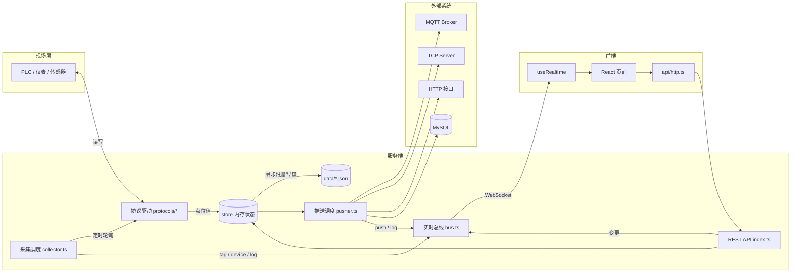

### 1. 启动初始化

1. `loadStore()` 读取 `data/*.json`；若不存在则回退读取旧版 `server/data/store.json` 并迁移。
2. 合并默认设置 `defaultSettings`，`refreshTagCounts()` 校正设备点位计数，`pruneColdData()` 清理冷数据与过期日志。
3. `server.listen(port)` 启动 HTTP（`PORT` 环境变量 > `settings.webPort` > 8080）。
4. `attachWss()` 挂载 WebSocket（`/ws`）；`syncCollector()`、`syncPusher()` 按当前配置启动调度。
5. 注册 `SIGINT` / `SIGTERM`：停止采集与推送 → 立即落盘 → 关闭服务。
6. 每小时执行一次 `pruneColdData()`，清理后按需写盘。

### 2. 采集工作流

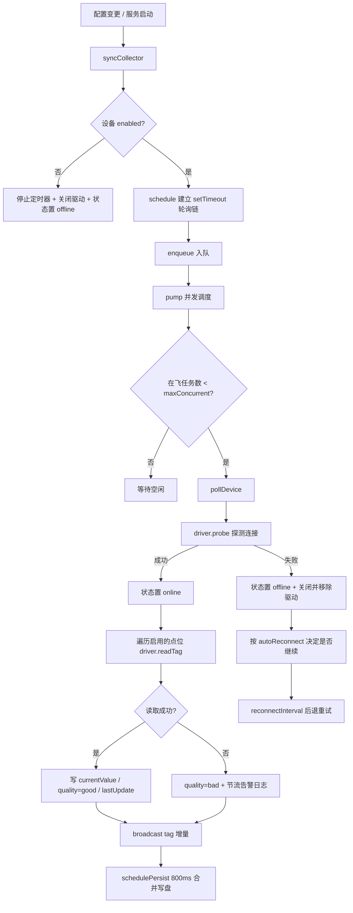

- **定时策略**：每台启用设备一条 `setTimeout` 自递归链；在线用 `pollInterval`（默认取全局轮询间隔，最小 200ms），离线用 `reconnectInterval`（最小 1000ms）。关闭 `autoReconnect` 后离线设备停止重试。
- **并发控制**：`queue` + `inFlight` 计数，最多同时采集 `maxConcurrent` 台设备；同一设备用 `polling` 去重，避免上一轮未结束就叠加。
- **驱动复用**：`drivers` 按设备 ID 缓存连接；连接失败时销毁驱动，下次轮询重建（自动重连）。
- **容错**：单台设备网络异常（`ETIMEDOUT` / `ECONNREFUSED`）只影响该设备；`unhandledRejection` / `uncaughtException` 统一记录日志而不退出进程。
- **点位写入**：`POST /api/tags/:id/write` → 校验非只读 → `driver.writeTag` → 更新实时值并广播。
- **连接测试**：`POST /api/devices/:id/test` 临时创建驱动执行 `probe`，超时保护后关闭，不占用轮询资源。

### 3. 推送工作流

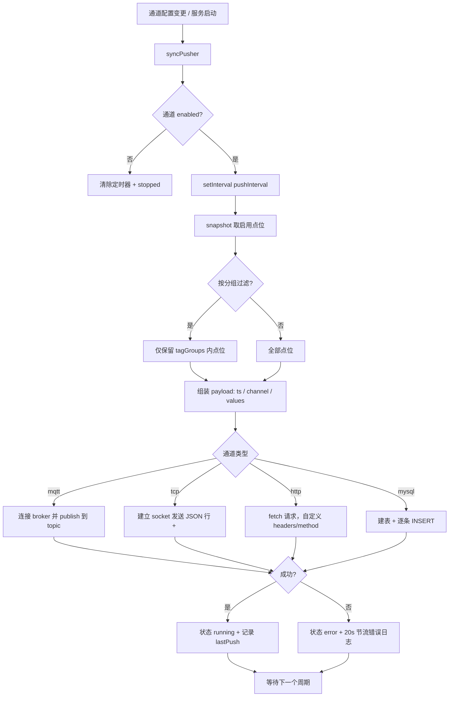

- 推送周期为 `pushInterval`（最小 300ms），首次调度立即执行一次。
- `tagFilter = group` 时按 `tagGroups` 过滤点位，否则推送全部启用点位。
- MySQL 通道默认自动 `CREATE TABLE IF NOT EXISTS`（`createTable` 关闭时不建表）。
- 推送失败仅标记通道为 `error` 并节流记录日志，不影响采集。

### 4. 实时通信工作流

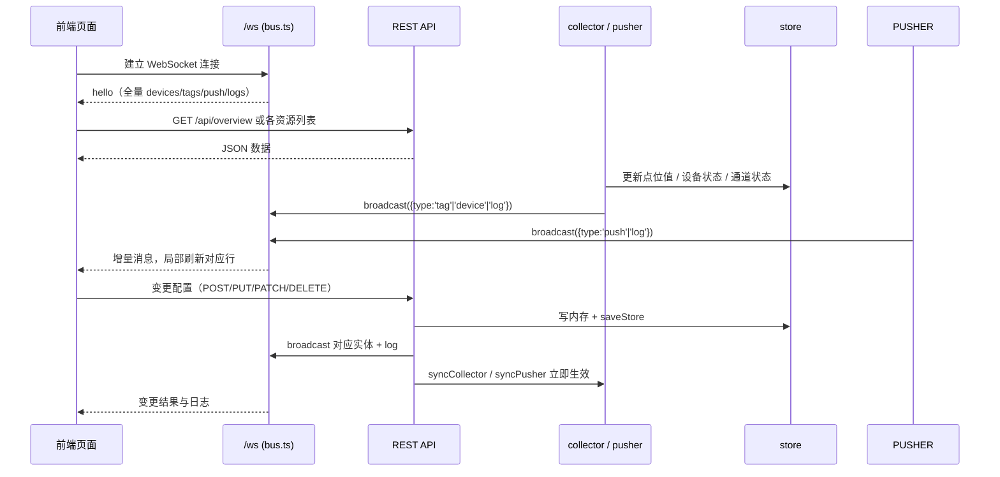

- 连接建立即收到 `hello` 全量快照，之后只接收增量：`tag`、`device`、`push`、`log`、`settings`。
- 前端 `useRealtime` 在 `onclose` 后 2 秒自动重连，页面无需刷新。
- 任何配置变更都会触发 `syncCollector()` / `syncPusher()`，无需重启服务。

### 5. 存储与冷数据清理

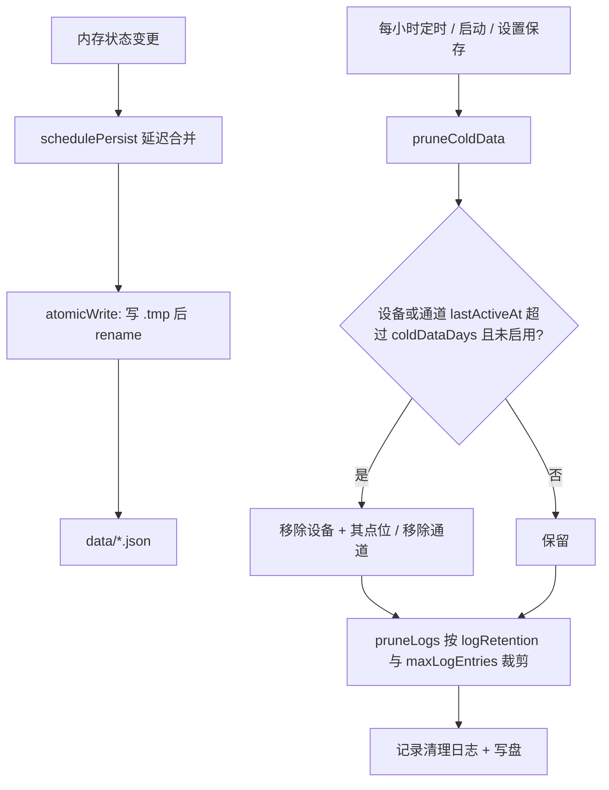


- 采集值高频更新，采用异步批量写盘（`collector` 800ms 合并，`store` 80ms 合并），避免高并发轮询时频繁同步写文件。
- 日志文件按 `logRetention`（天）和 `maxLogEntries`（条）双重限制裁剪。
- 长期未启用的设备、点位和推送会按「冷数据保留天数」自动清理。

## 数据文件

配置和运行数据保存在项目根目录 `data/` 下的 JSON 文件：

- `data/settings.json` 系统设置
- `data/devices.json` 设备
- `data/tags.json` 点位
- `data/push.json` 推送通道
- `data/logs.json` 日志

旧版 `server/data/store.json` 会在首次启动时自动迁移到上述文件。

## API 概览

| 方法                        | 路径                                | 说明                           |
| ------------------------- | --------------------------------- | ---------------------------- |
| GET                       | `/api/overview`                   | 设备、点位、通道、日志与统计               |
| GET/POST/PUT/PATCH/DELETE | `/api/devices`、`/api/devices/:id` | 设备增删改查                       |
| POST                      | `/api/devices/:id/test`           | 设备连接测试                       |
| GET/POST/PUT/PATCH/DELETE | `/api/tags`、`/api/tags/:id`       | 点位增删改查（支持 `deviceId`、`q` 过滤） |
| POST                      | `/api/tags/import`                | 点位批量导入（CSV 解析后提交）            |
| POST                      | `/api/tags/:id/write`             | 点位写入                         |
| GET/POST/PUT/PATCH/DELETE | `/api/push`、`/api/push/:id`       | 推送通道增删改查                     |
| GET/DELETE                | `/api/logs`                       | 日志查询（级别、来源、关键字、条数）与清空        |
| GET/PUT                   | `/api/settings`                   | 系统设置读取与保存                    |
| WS                        | `/ws`                             | 实时消息通道                       |

## 启动

```bash
npm install
npm run dev
```

Windows 下也可以直接双击项目根目录的 `start.bat` 一键启动（首次运行会自动安装依赖）。

前端默认 <http://127.0.0.1:5173>，API 和 WebSocket 在 <http://127.0.0.1:8080>。

仅启动后端：

```bash
npm run server
```

生产构建后由后端直接托管 `dist/`，访问 `http://127.0.0.1:8080` 即可。

### 可用脚本

| 脚本                   | 说明                               |
| -------------------- | -------------------------------- |
| `npm run dev`        | 并行启动后端（`tsx watch`，热重载）与前端（Vite） |
| `npm run dev:web`    | 仅启动前端开发服务器（5173）                 |
| `npm run dev:server` | 仅启动后端，文件变更自动重启（8080）             |
| `npm run server`     | 仅启动后端（无监听）                       |
| `npm run build`      | 类型检查 + 前端打包到 `dist/`             |
| `npm run preview`    | 预览构建产物                           |
| `npm run lint`       | oxlint 静态检查                      |

## 扩展协议驱动

1. 在 `server/src/protocols/` 新建驱动文件，继承 `BaseDriver` 并实现 `connect` / `probe` / `readTag` / `writeTag` / `close`。
2. 在 `protocols/index.ts` 的 `createDriver()` 中按 `device.protocol` 返回新实例，并加入 `isSupported()`。
3. 在前端 `src/data/protocolConfigs.ts` 中补充协议元数据（连接字段、数据类型、字节序、地址示例），表单会自动渲染。

## 图片展示

首页可以基础到所有设备以及采集的点位

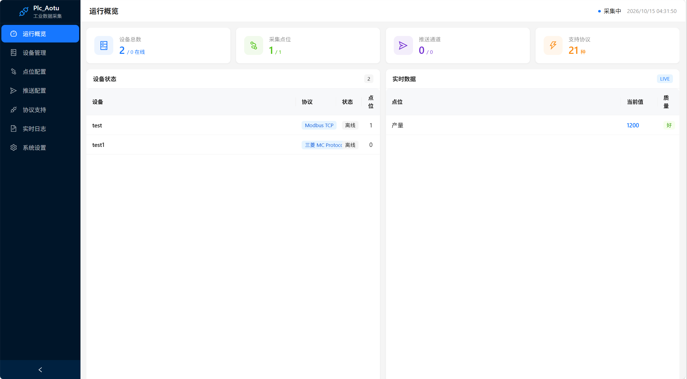

设备管理可添加要采集的对象，比如采集高斯的就填高斯设备的名字，我这里以test为例，点测试即可查看网络是否可达

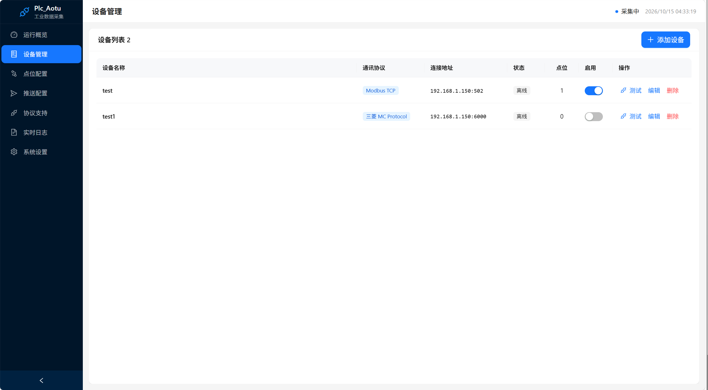

点位配置就是要添加的点位，寄存器变量，但是要先选择设置，然后添加数据，可实时查看数据

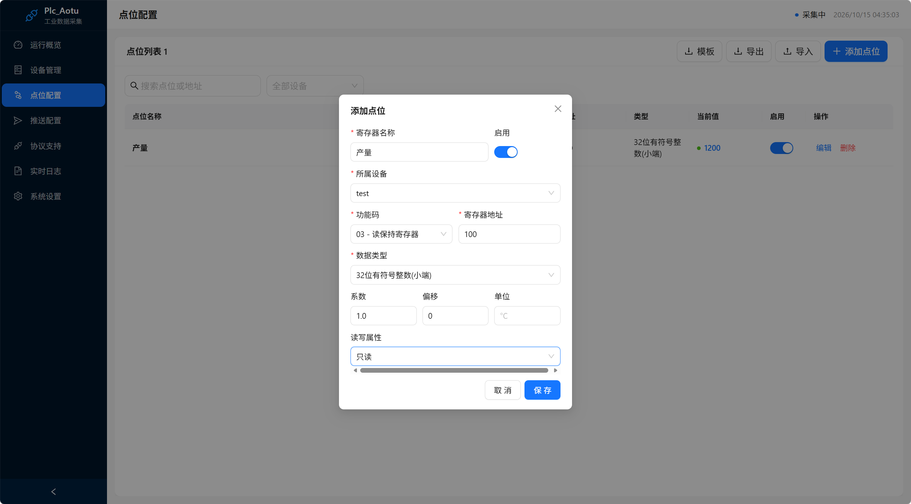

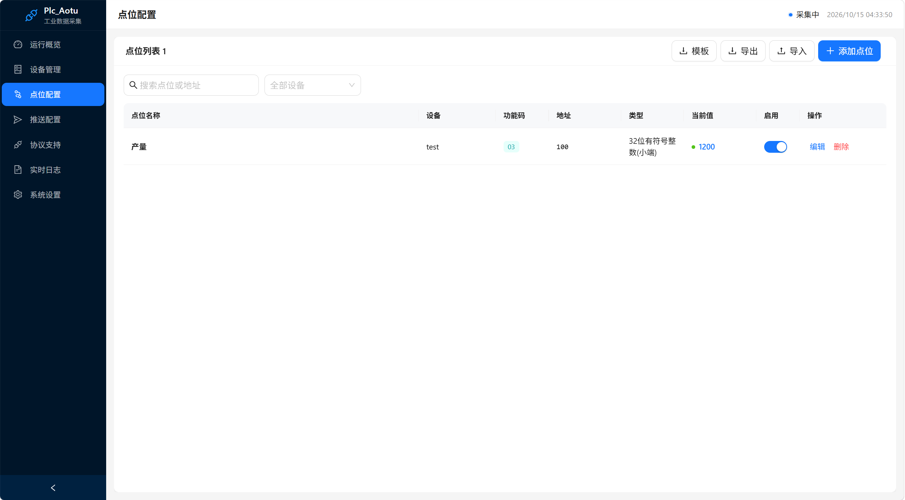

推送配置，就是将数据推送到服务器或者数据库，比如常用MQTT

| 协议            | 连接类型          | 实时性   | 可靠性    | 带宽开销 | 运维成本          | 推荐场景             |
| ------------- | ------------- | ----- | ------ | ---- | ------------- | ---------------- |
| MQTT          | 长连接 (Pub/Sub) | ⭐⭐⭐⭐⭐ | QoS 可控 | 极低   | 中等（需要 Broker） | IoT、工控实时测点推送     |
| TCP 原生        | 长连接点对点        | ⭐⭐⭐⭐⭐ | 需自己实现  | 最低   | 高（私有协议开发）     | 自研高性能内部通信        |
| HTTP(Webhook) | 默认短连接         | ⭐⭐    | 需要自己重试 | 较高   | 低             | 对接业务 Web 接口、告警事件 |
| MySQL 直写      | 数据库连接         | ⭐⭐    | 数据库事务  | 高    | 低             | 数据归档存储，不适合高频实时推送 |

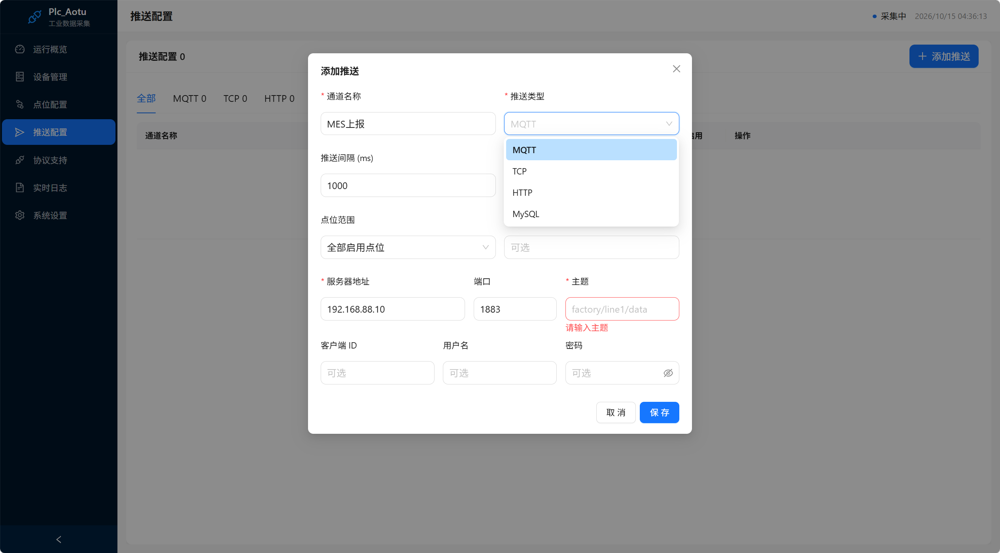

协议支持，可以选择不同的协议方式，或者直接写modbusTCP，大部分PLC和仪表都支持

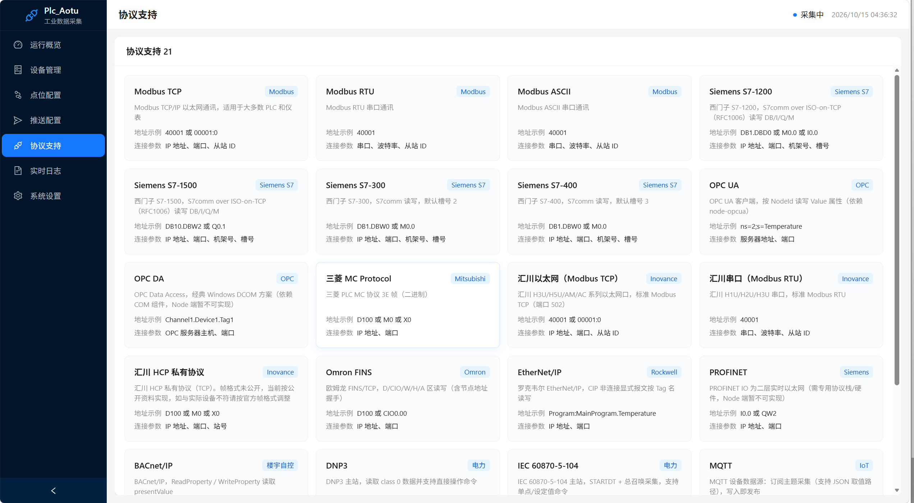
